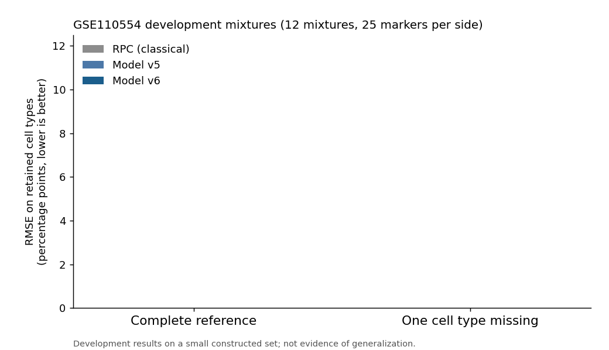

# In-context methylation deconvolution

Estimating the cell-type composition of a blood DNA methylation sample works well when the reference panel contains every cell type in the sample. It works badly when a type is missing, because classical solvers push the missing type's signal onto the types that remain. This project asks whether a single network, trained only on simulated mixtures, can take an arbitrary reference panel and a bulk profile and return cell-type fractions plus an explicit "other" fraction for mass the reference cannot explain.

<p align="center">
  
</p>

*Error on retained cell types for GSE110554 development mixtures. Static version: [docs/hero.png](docs/hero.png). Regenerate with `python docs/make_figures.py`.*

> **Status: research prototype.** These are development results on 12 constructed mixtures. They show that the approach is worth pursuing, not that it generalizes. Uncertainty estimates have not been validated on independent real data, and the model has no demonstrated advantage over cheap diagnostics for detecting a missing type (see below).

## How it works

- **Input:** a reference panel (per-type methylation profiles), a bulk beta-value profile, and optionally other samples from the same cohort.
- **Output:** fractions for each reference type, an "other" fraction, and an interval for each.
- **Training:** simulated mixtures of sorted-cell profiles from several public GEO series, with randomly dropped types and study-level offsets. The network also receives the fit and residuals of robust partial correlation (RPC), so it starts from a strong classical estimate.
- **Evaluation:** truth-labelled public mixtures, scored against RPC, NNLS, constrained projection and other published solvers. The protocol and the role of each dataset are in [deconv/EVALUATION.md](deconv/EVALUATION.md).

## Results so far

Retained-type RMSE in percentage points on GSE110554 (12 mixtures, 25 markers per side). Lower is better.

| Method | Complete reference | One type missing |
|---|---:|---:|
| RPC | **1.7** | 10.7 |
| Model v5 | 2.8 | **4.0** |
| Model v6 | 2.3 | **4.0** |

Per-drop and per-type breakdowns are in [`deconv/results/`](deconv/results/). What the evidence supports and what it does not:

- **Missing types:** both models cut retained-type error by about 60% when a type is missing, and about 30% when the neutrophil drop is excluded. The gain is smaller on that subset because the neutrophil drop is where RPC does worst.
- **Complete references:** RPC is still more accurate, and the models report some "other" mass (about 6 points) when nothing is missing.
- **Detection:** the model's "other" fraction separates complete from incomplete references with AUROC 0.78. CETYGO, a free diagnostic, reaches 0.82 and RPC's residual 0.79 ([detection baselines](deconv/results/detection_baselines/README.md)).
- **Identifiability:** T-cell subsets and eosinophils versus neutrophils lie almost on top of each other in methylation space, so omitting one of them is largely unrecoverable from the bulk profile alone ([identifiability map](deconv/results/identifiability_map/README.md)).
- **Cohort input:** giving v6 the whole cohort did not help on GSE110554 and is not supported by the current evidence. `gpu_v6_nocohort_seed0` is the better checkpoint.
- **Against BLEND-M:** on synthetic mixtures, BLEND-M with individual reference samples is clearly better than the model when the reference is complete (cross-study: 2.1 vs 6.4 points). The model is slightly ahead when the reference is reduced (6.4 vs 6.8). See the [BLEND-M baseline](deconv/results/blendm_baseline/README.md).

## Repository layout

| Path | Contents |
|---|---|
| `deconv/datasets.py`, `geo.py`, `reprocess.py`, `noob_idats.R` | GEO loading and Noob preprocessing |
| `deconv/reference.py`, `solvers.py`, `run_baselines.py`, `blendm*.py` | Reference construction and classical or published baselines |
| `deconv/simulator.py`, `rpc_torch.py`, `model.py`, `train_cpu.py` | Mixture simulator and the reference-conditioned model |
| `deconv/eval_real_dev.py`, `diagnostics.py`, `identifiability_map.py`, `missing_mass_bounds.py` | Development evaluation and diagnostics |
| `deconv/results/` | Saved summaries and per-run write-ups. Raw data, caches and checkpoints are not included. |
| `tests/` | Unit tests on small synthetic inputs |
| `docs/` | Figures and the script that builds them |

## Getting started

Python 3.10 or newer.

```bash
python -m venv .venv
source .venv/bin/activate        # on Windows: .venv\Scripts\activate
pip install -r requirements.txt
python -m pytest -q tests
```

Some tests need `Rscript` plus the EpiDISH, EMeth, ICeDT and FARDEEP packages; model tests need PyTorch. Dependencies are not pinned, so record versions if you need exact replication.

### Reproducing the benchmarks

Data are not bundled. `deconv/data_manifest.json` lists GEO URLs and hashes for the original downloads.

1. Download the series matrices to `<data>/raw/<GSE>/<GSE>_series_matrix.txt.gz` and set `DECONV_RAW=<data>/raw`. The Noob cache is written to `<data>/cache`.
2. For uniform preprocessing, install R with Bioconductor `minfi` and the 450K and EPIC annotation packages, then from `deconv/` run:

```bash
python reprocess.py all
python run_baselines.py --preproc noob --no-epidish --no-paper
```

`reprocess.py all` downloads large IDAT archives and needs substantial disk space. Drop `--no-epidish` and `--no-paper` to include the R solvers. Checkpoints are not included, so model evaluations require training first (`python train_cpu.py --help`).

## Limitations

- Small samples, uncertain donor independence across series, and different platforms and preprocessing limit what the real-data checks can show.
- Noob does not remove Infinium probe-type bias, and no cross-reactive or SNP probe mask is applied.
- GSE110554 has been examined repeatedly during development, so its numbers are optimistic. The planned held-out test (GSE167998 reference, GSE182379 mixtures) has not been run.

## References

- [EpiDISH](https://bioconductor.org/packages/EpiDISH/) and the [methylation deconvolution benchmark](https://doi.org/10.1038/s41467-024-48466-z).
- BLEND-M is vendored under `deconv/vendor/BLENDM/` with its original licence.
